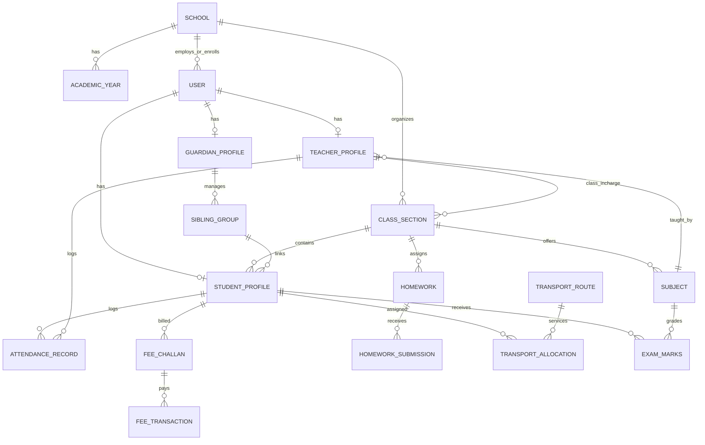

# Al-Falah SchoolOS — System Architecture & Complete Tech Stack

This document specifies the complete, production-grade technical architecture, system layers, hardware integrations, and technology stacks for the **A-to-Z School Management System**.

---

## 1. High-Level Architectural Diagram

```
+---------------------------------------------------------------------------------------+
|                                    CLIENT PLATFORMS                                   |
|  [Desktop Admin Hub]      [Teacher Tablet/Web]      [Student/Parent Web & Mobile PWA] |
+-------------------------------------------+-------------------------------------------+
                                            | HTTPS / WSS / JWT
+-------------------------------------------v-------------------------------------------+
|                          EDGE & REVERSE PROXY LAYER (Cloudflare)                      |
|                  DDoS Protection · SSL Termination · WAF · Tunnel Ingress              |
+-------------------------------------------+-------------------------------------------+
                                            |
+-------------------------------------------v-------------------------------------------+
|                          APPLICATION LAYER (Next.js 15+ / React 19)                   |
|  - App Router (/admin, /teacher, /student, /finance, /transport)                      |
|  - Server Actions & Type-Safe API Route Handlers                                      |
|  - NextAuth / Supabase Auth (Multi-Role RBAC & Row Level Security)                    |
|  - PDF Generation Service (Triplicate Bank Challans, BSEK Cards, 110mm Admit Passes)  |
|  - SheetJS Excel Engine (1-Click Bulk Student & Faculty Import/Export)                |
|  - Digital Homework & Daily Diary Engine                                              |
|  - Mobile Payment Webhooks (JazzCash, Easypaisa, Safepay IPN)                         |
+---------------------+-------------------------------+---------------------------------+
                      |                               |
       Database Queries (Prisma / Postgres) Hardware Push / Webhook
                      |                               |
+---------------------v---------------+ +-------------v---------------------------------+
|     DATA LAYER (PostgreSQL 16)      | |      HARDWARE BIOMETRIC INTEGRATION ENGINE     |
| - Multi-Campus / BSEK Affiliation   | | - Local LAN Edge Relay Daemon (Python/Node)   |
| - Users & Strict RBAC Matrix        | | - ZKTeco / Realtime / eSSL Device SDK Socket  |
| - Students, Siblings, Faculty Tables| | - RFID Gate Card Readers & Fingerprint Scans   |
| - Attendance Logs with Timestamps   | | - Real-time Clock-In / Clock-Out Ingestion     |
| - Finance, Ledgers, 3-Part Challans | | - 15m Grace Period & Auto-Late Calculator      |
| - Transport Fleet & Route Billing   | +-----------------------------------------------+
| - Automated Monthly Billing pg_cron |
+-------------------------------------+
```

---

## 2. Technology Stack Selection & Specifications

### 2.1 Frontend & User Experience (UX) Stack
| Component | Technology | Rationale & Enterprise Justification |
| :--- | :--- | :--- |
| **Framework** | **Next.js 15+ (App Router)** | Industry gold standard for production web apps. Hybrid SSR/SSG ensures instant page loads, SEO for public school portals, and secure Server Components. |
| **Language** | **TypeScript (Strict Mode)** | End-to-end type safety across database schemas, API payloads, and portal interfaces to eliminate runtime errors. |
| **Styling** | **Tailwind CSS + CSS Modules** | Zero-runtime CSS, ultra-fast rendering, responsive across mobile, tablets, and high-res administrative displays. |
| **UI Component Library** | **Shadcn UI + Radix UI Primitives** | Unstyled accessible primitives, fully customizable, zero vendor lock-in. |
| **Icons & Media** | **Lucide Icons + FontAwesome 6 Pro** | Crisp, comprehensive iconography for administrative controls, academic subjects, and financial statuses. |
| **Data Tables** | **TanStack Table v8** | Virtualized row rendering for 1000+ student rosters with column filtering, multi-sort, and CSV/Excel exports. |
| **Charts & Analytics** | **Recharts / Tremor** | Beautiful visual KPI dashboards for attendance punctuality, fee collection curves, and student GPA trends. |
| **Bulk Import / Export** | **SheetJS (xlsx)** | 1-Click bulk import of entire student rosters and faculty lists directly from school administration Excel sheets. |
| **Printing & PDF** | **@react-pdf/renderer + Browser Print CSS** | Generates pixel-perfect 3-part bank challans (Bank/School/Student copies), 110mm admit cards, and BSEK report cards. |

---

### 2.2 Backend & Application Layer Stack
| Component | Technology | Rationale & Enterprise Justification |
| :--- | :--- | :--- |
| **Runtime** | **Node.js 22 LTS / Bun** | High-performance asynchronous execution for handling hundreds of concurrent roll-call entries and ledger operations. |
| **API Architecture** | **Next.js Server Actions + REST APIs** | Zero-boilerplate server-side data fetching and mutation with automatic cache invalidation and CSRF protection. |
| **Validation** | **Zod v3** | Strict schema validation on all client submissions (admissions, marks entry, fee adjustments). |
| **Authentication & RBAC** | **NextAuth.js / Supabase Auth** | Multi-role credential authentication (Email/Username/Roll No + Password), bcrypt password hashing, and encrypted JWT tokens. |
| **Scheduled Jobs & Invoicing** | **pg_cron / BullMQ (Redis)** | Automated monthly fee invoice generation on the 1st of every month, automated attendance cutoffs, and daily backup jobs. |
| **Payment Gateways** | **JazzCash, Easypaisa, Safepay / PayFast** | Instant digital mobile wallet payment webhooks alongside traditional Pakistani 3-part bank challans. |
| **SMS & WhatsApp Gateway** | **Local Telco SMS API + Twilio/WhatsApp** | Instant automated SMS to parents when a student is absent at the morning gate or fee is overdue. |

---

### 2.3 Database & Storage Layer
| Component | Technology | Rationale & Enterprise Justification |
| :--- | :--- | :--- |
| **Primary Database** | **PostgreSQL 16 (Supabase / Self-Hosted)** | Robust relational database with ACID guarantees, essential for school financial ledgers and academic grading integrity. |
| **ORM / Query Builder** | **Prisma ORM** | Type-safe migrations, auto-generated TypeScript clients, and intuitive relational querying across students, classes, and teachers. |
| **Security at DB Layer** | **Row Level Security (RLS)** | Database-level guarantees ensuring students and parents can strictly never query other students' marks or balances. |
| **Caching & In-Memory Store** | **Redis 7** | Sub-millisecond caching for master timetables, active session tokens, and hardware attendance rate-limiting. |
| **File & Asset Storage** | **Cloudflare R2 / S3 / Supabase Storage** | Secure storage for student B-Form scans, admission photos, teacher CNICs, and homework attachments. |

---

### 2.4 Hardware & Biometric Attendance Integration Stack

School management systems in Pakistan require bulletproof teacher and student attendance tracking that prevents proxy sign-ins.

```
+------------------------------------+
|  Biometric Terminal (On Campus)    |
|  (e.g., ZKTeco K40 / VF380 / MB20) |
+-----------------+------------------+
                  | TCP/IP (Local School LAN)
+-----------------v------------------+
| Local Hardware Daemon (Edge Relay) |
| - Runs on Admin PC (Python / Go)   |
| - Pulls punches via pyzk / SDK     |
+-----------------+------------------+
                  | HTTPS REST Webhook / Encrypted API Key
+-----------------v------------------+
| Cloud Backend Attendance Ingestion |
| - Validates Machine ID & Timestamp |
| - Computes Punctuality & Grace Min |
| - Updates Teacher/Student Database |
+------------------------------------+
```

* **Device Protocols:** ZKTeco Standalone SDK / pyzk (Python ZK Library) over TCP/IP Port 4370.
* **Edge Ingestion Daemon:** A lightweight local service installed on the school's local administrative PC. It continuously listens for biometric machine events (fingerprint scan, face recognition, RFID card tap).
* **Clock-in / Clock-out Logic:**
  * **Teacher Rules:** Grace period until 08:00 AM. Arrival between 08:00–08:15 AM marked "Late". 3 Late arrivals = 1/2 day salary deduction rule.
  * **Student Rules:** Gate closes at 08:00 AM. Fingerprint tap records gate arrival timestamp. Trigger automated SMS/WhatsApp notification to guardian if absent by 08:30 AM.

---

## 3. Core Database Models & Relationships



### 3.1 Primary Database Tables:
1. `users` (id, school_id, email, username, password_hash, role [SUPER_ADMIN, TEACHER, STUDENT, ACCOUNTANT, GUARDIAN], status, created_at)
2. `teachers` (id, user_id, employee_id, full_name, qualification, designation, basic_salary, joined_date, phone, incharge_class_id)
3. `students` (id, user_id, roll_number, b_form_number, full_name, father_name, guardian_id, sibling_group_id, current_class_id, admission_date, status)
4. `sibling_groups` (id, guardian_id, family_code, discount_percentage [e.g., 20% on 2nd child, 50% on 3rd child])
5. `class_sections` (id, name, numeric_level [Nursery..10], stream [Science, General], class_teacher_id)
6. `subjects` (id, name, code, class_id, primary_teacher_id, weekly_periods)
7. `attendance_logs` (id, user_id, role, date, clock_in_time, clock_out_time, status [PRESENT, LATE, ABSENT, LEAVE], source [BIOMETRIC, MANUAL_PORTAL])
8. `fee_challans` (id, student_id, month, year, tuition_fee, lab_fee, transport_fee, sibling_concession, arrears, total_amount, due_date, status [UNPAID, PAID, OVERDUE], bank_ref, online_txn_id)
9. `transport_routes` (id, route_name, vehicle_number, driver_name, driver_phone, monthly_fare, stops_json)
10. `homework_diary` (id, class_id, subject_id, teacher_id, title, description, attachment_url, due_date)
11. `exam_results` (id, student_id, subject_id, term [MIDTERM, FINAL], ca_score_40, terminal_score_60, total_marks, grade, gpa)

---

## 4. Role-Based Access Control (RBAC) Permission Matrix

| Module / Operation | Super Admin | Teacher | Student / Parent | Accountant |
| :--- | :---: | :---: | :---: | :---: |
| **All Teachers Directory & Salaries** | Full (CRUD) | ❌ Denied | ❌ Denied | Read/Payroll Only |
| **My Personal Teacher Workspace** | Full (Inspect) | Own Profile Only | ❌ Denied | ❌ Denied |
| **All Students Directory (All Classes)** | Full (CRUD) | ❌ Denied | ❌ Denied | Read Only |
| **My Assigned Class Students** | Full (CRUD) | Own Classes (Read/CA) | ❌ Denied | ❌ Denied |
| **Daily Attendance Register** | School-wide | Own Incharge Class | ❌ Denied | ❌ Denied |
| **My Personal Attendance / Report** | Full (All) | Own Log Only | Own Log Only | ❌ Denied |
| **Marks Entry & Exam Grading** | Final Lock | Own Subject Entry | ❌ Denied | ❌ Denied |
| **Fee Challan Generation & Ledger** | Full Oversight | ❌ Denied | Own Challan View/Pay | Full (CRUD & Collect) |
| **Online Payments (JazzCash/Easypaisa)** | Read/Reconcile | ❌ Denied | Instant Pay Button | Reconcile / Webhooks |
| **Homework & Daily Digital Diary** | Oversight | Create & Review | View & Submit | ❌ Denied |
| **Transport & Van Fleet Management** | Full (CRUD) | ❌ Denied | View Route / Stop | Route Fee Billing |
| **Excel Bulk Import / Export (SheetJS)** | Full (Import/Export) | Export Own Class | ❌ Denied | Export Fee Lists |
| **Hardware & Biometric Ingestion** | Full Config | Read Own Clock-in | Read Own Arrival | ❌ Denied |

---

## 5. Security & Compliance Architecture

1. **Password Security:** Salted `bcrypt` hashing with work factor 12.
2. **Session Security:** HTTP-Only, Secure, SameSite cookies with short-lived JWTs and Redis-backed refresh token rotation.
3. **Database RLS:** Row-Level Security ensuring parents cannot view other students' records or financial ledgers.
4. **Data Protection:** Database connection over TLS with SSL certificate enforcement; daily automated snapshot backups stored off-site.
5. **Audit Logs:** Immutable audit log table recording every financial transaction, mark alteration, and administrative privilege escalation.
