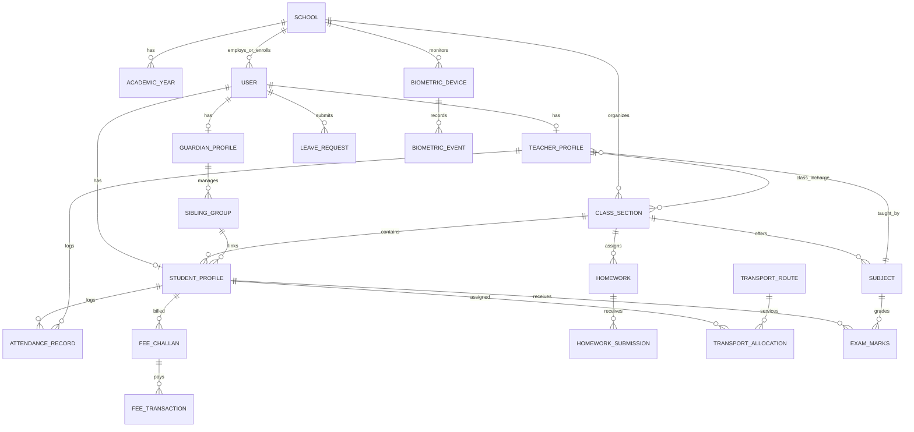

# Al-Falah SchoolOS — System Architecture & Complete Tech Stack

This document specifies the complete, production-grade technical architecture, system layers, hardware integrations, mobile geofencing engines, and technology stacks for the **A-to-Z School Management System**.

---

## 1. High-Level Architectural Diagram

```
+---------------------------------------------------------------------------------------------------+
|                                          CLIENT PLATFORMS                                         |
|  [Admin/Principal Desk]  [Teacher Tablet/Web]  [Student/Parent PWA]  [Receptionist/Front Desk]    |
+-------------------------------------------------+-------------------------------------------------+
                                                  | HTTPS / WSS / JWT
+-------------------------------------------------v-------------------------------------------------+
|                                EDGE & REVERSE PROXY LAYER (Cloudflare)                            |
|                        DDoS Protection · SSL Termination · WAF · Tunnel Ingress                   |
+-------------------------------------------------+-------------------------------------------------+
                                                  |
+-------------------------------------------------v-------------------------------------------------+
|                                APPLICATION LAYER (Next.js 15+ / React 19)                         |
|  - App Router (/admin, /principal, /teacher, /student, /finance, /reception, /transport)          |
|  - Server Actions & Type-Safe API Route Handlers                                                  |
|  - NextAuth / Supabase Auth (Multi-Role RBAC & Row Level Security)                                |
|  - DUAL-MODE ATTENDANCE INGESTION:                                                                |
|    * MODE A: Hardware Push (ZKTeco ADMS & TCP/IP 4370 Bridge)                                     |
|    * MODE B: Zero-Hardware ($0 Cost) Mobile Geofence (50m Radius) + WebAuthn Fingerprint Check-in |
|  - PDF Generation Service (Triplicate Bank Challans, BSEK Cards, 110mm Admit Passes, Certificates)|
|  - SheetJS Excel Engine (1-Click Bulk Student & Faculty Import/Export)                            |
|  - Digital Homework & Daily Diary Engine                                                          |
|  - Leave Management & Approval Engine                                                             |
|  - Mobile Payment Webhooks (JazzCash, Easypaisa, Safepay IPN)                                     |
+---------------------------+-----------------------------------+-----------------------------------+
                            |                                   |
             Database Queries (Prisma / Postgres)    Dual Ingestion (ADMS / WebAuthn)
                            |                                   |
+---------------------------v---------------+   +---------------v-----------------------------------+
|          DATA LAYER (PostgreSQL 16)       |   |      ATTENDANCE & BIOMETRIC INGESTION ENGINES      |
| - Multi-Campus / BSEK Affiliation         |   | 1. HARDWARE ENGINE (ZKTeco / eSSL):               |
| - Users & Strict RBAC Matrix              |   |    - TCP/IP 4370 + ADMS Web Push                  |
| - Students, Siblings, Faculty, Staff      |   |    - Offline Buffer Sync & Device Heartbeat       |
| - Attendance Logs with Geo & Biometric sig|   |    - SHA-256 Idempotency Duplicate Punch Filter   |
| - Raw Biometric Events & Auto Clock-in/out|   | 2. ZERO-HARDWARE MOBILE GEOFENCE ENGINE:          |
| - Finance, Ledgers, 3-Part Challans       |   |    - HTML5 Geolocation (< 50m School Radius)      |
| - Visitor Logs, Admissions, Leaves        |   |    - W3C WebAuthn API (Mobile Fingerprint/FaceID) |
| - Automated Monthly Billing pg_cron       |   |    - Zero App Download (Pure Web & PWA)           |
+-------------------------------------------+   +---------------------------------------------------+
```

---

## 2. Technology Stack Selection & Specifications

### 2.1 Frontend & User Experience (UX) Stack
| Component | Technology | Rationale & Enterprise Justification |
| :--- | :--- | :--- |
| **Framework** | **Next.js 15+ (App Router)** | Industry gold standard for production web apps. Hybrid SSR/SSG ensures instant page loads, SEO for public school portals, and secure Server Components. |
| **Language** | **TypeScript (Strict Mode)** | End-to-end type safety across database schemas, API payloads, and portal interfaces to eliminate runtime errors. |
| **Styling** | **Tailwind CSS + CSS Modules** | Zero-runtime CSS, ultra-fast rendering, responsive across mobile, tablets, and high-res administrative displays. |
| **UI Component Library** | **Shadcn UI + Radix UI Primitives** | Unstyled accessible primitives, fully customizable, zero vendor lock-in. |
| **Icons & Media** | **Lucide Icons + FontAwesome 6 Pro** | Crisp, comprehensive iconography for administrative controls, academic subjects, and financial statuses. |
| **Data Tables** | **TanStack Table v8** | Virtualized row rendering for 1000+ student rosters with column filtering, multi-sort, and CSV/Excel exports. |
| **Charts & Analytics** | **Recharts / Tremor** | Beautiful visual KPI dashboards for attendance punctuality, fee collection curves, and student GPA trends. |
| **Bulk Import / Export** | **SheetJS (xlsx)** | 1-Click bulk import of entire student rosters and faculty lists directly from school administration Excel sheets. |
| **Printing & PDF** | **@react-pdf/renderer + Browser Print CSS** | Generates pixel-perfect 3-part bank challans (Bank/School/Student copies), 110mm admit cards, and BSEK report cards. |

---

### 2.2 Backend & Application Layer Stack
| Component | Technology | Rationale & Enterprise Justification |
| :--- | :--- | :--- |
| **Runtime** | **Node.js 22 LTS / Bun** | High-performance asynchronous execution for handling hundreds of concurrent roll-call entries and ledger operations. |
| **API Architecture** | **Next.js Server Actions + REST APIs** | Zero-boilerplate server-side data fetching and mutation with automatic cache invalidation and CSRF protection. |
| **Validation** | **Zod v3** | Strict schema validation on all client submissions (admissions, marks entry, fee adjustments). |
| **Authentication & RBAC** | **NextAuth.js / Supabase Auth** | Multi-role credential authentication (Email/Username/Roll No + Password), bcrypt password hashing, and encrypted JWT tokens. |
| **Scheduled Jobs & Invoicing** | **pg_cron / BullMQ (Redis)** | Automated monthly fee invoice generation on the 1st of every month, automated attendance cutoffs, and daily backup jobs. |
| **Payment Gateways** | **JazzCash, Easypaisa, Safepay / PayFast** | Instant digital mobile wallet payment webhooks alongside traditional Pakistani 3-part bank challans. |
| **SMS & WhatsApp Gateway** | **Local Telco SMS API + Twilio/WhatsApp** | Instant automated SMS to parents when a student is absent at the morning gate or fee is overdue. |

---

### 2.3 Database & Storage Layer
| Component | Technology | Rationale & Enterprise Justification |
| :--- | :--- | :--- |
| **Primary Database** | **PostgreSQL 16 (Supabase / Self-Hosted)** | Robust relational database with ACID guarantees, essential for school financial ledgers and academic grading integrity. |
| **ORM / Query Builder** | **Prisma ORM** | Type-safe migrations, auto-generated TypeScript clients, and intuitive relational querying across students, classes, and teachers. |
| **Security at DB Layer** | **Row Level Security (RLS)** | Database-level guarantees ensuring students and parents can strictly never query other students' marks or balances. |
| **Caching & In-Memory Store** | **Redis 7** | Sub-millisecond caching for master timetables, active session tokens, and hardware attendance rate-limiting. |
| **File & Asset Storage** | **Cloudflare R2 / S3 / Supabase Storage** | Secure storage for student B-Form scans, admission photos, teacher CNICs, and homework attachments. |

---

### 2.4 Hardware & Biometric Attendance Integration Stack (Mode A)

Designed for schools with physical on-campus attendance terminals:

```
+------------------------------------------+
|      Biometric Terminals (On Campus)     |
|   (e.g., ZKTeco K40 / VF380 / MB20 / F22)|
+--------------------+---------------------+
                     | TCP/IP (4370) or ADMS HTTP Push
+--------------------v---------------------+
|      Local Edge Relay & Buffer Daemon    |
| - Runs on Admin PC (Python / Go)         |
| - Local SQLite/Buffer for net outages    |
| - Pulls punches & pings heartbeat        |
+--------------------+---------------------+
                     | HTTPS Encrypted Webhook Payload
+--------------------v---------------------+
|     Cloud Attendance Ingestion Engine    |
| 1. Idempotency Check (Filter duplicates) |
| 2. Raw Log Store in biometric_events     |
| 3. Worker computes Clock-in & Clock-out  |
| 4. Late Rule (08:00 AM grace cutoff)     |
| 5. Heartbeat Registry (Device health)    |
+------------------------------------------+
```

* **Device Protocols:** ZKTeco Standalone SDK / pyzk over TCP/IP Port 4370 + ADMS Cloud Push.
* **De-duplication & Idempotency:** Calculates SHA-256 hash `hash(device_id + user_id + timestamp_minute)` to ignore accidental multiple scans within 2 minutes.
* **Clock-in / Clock-out Engine:** Earliest punch of the day = `Clock-in`; Latest punch of the day = `Clock-out`.

---

### 2.5 Zero-Hardware Cost Mobile Geofencing & Biometric Check-In (Mode B)

Designed for schools that do **not** want to purchase expensive physical biometric hardware ($0 hardware budget).

```
+--------------------------------------------------------------------------+
|                         TEACHER'S SMARTPHONE (WEB / PWA)                 |
|  1. Teacher arrives at campus (Morning 07:45 AM)                         |
|  2. Opens Teacher Portal in Mobile Chrome/Safari                         |
|  3. Taps: "Mark Attendance (Check-In)"                                   |
+------------------------------------+-------------------------------------+
                                     |
                                     v
+--------------------------------------------------------------------------+
|                       STEP 1: GPS GEOFENCE VALIDATION                    |
| - HTML5 Geolocation API: navigator.geolocation.getCurrentPosition()     |
| - Calculates Haversine distance to School Coordinates (e.g. Orangi Town) |
| - IF Distance > 50 meters: ❌ ACCESS DENIED ("You are not at school!")  |
| - IF Distance <= 50 meters: ✅ CAMPUS PRESENCE CONFIRMED                 |
+------------------------------------+-------------------------------------+
                                     |
                                     v
+--------------------------------------------------------------------------+
|                    STEP 2: NATIVE BIOMETRIC VERIFICATION (WebAuthn)      |
| - W3C Web Authentication API: navigator.credentials.get()                |
| - Android / iOS prompts system hardware fingerprint or FaceID dialog     |
| - Zero Python / Zero native app installation needed (Runs 100% in Web)   |
| - Teacher touches phone sensor -> Cryptographic proof returned           |
+------------------------------------+-------------------------------------+
                                     |
                                     v
+--------------------------------------------------------------------------+
|                      STEP 3: SERVER-SIDE ATTENDANCE LOG                  |
| - Verifies cryptographic signature + GPS coordinate stamp                |
| - Saves record: [Source: MOBILE_GEOFENCE_WEBAUTHN, Status: PRESENT]      |
| - Updates Principal live dashboard & calculates 08:00 AM grace cutoff    |
+--------------------------------------------------------------------------+
```

#### Key Advantages of Mode B:
1. **$0 Capital Expenditure:** Zero machine purchases, zero wiring, zero maintenance fees.
2. **Anti-Cheating & Anti-Proxy:**
   - Geofencing prevents marking attendance from home.
   - WebAuthn fingerprint sensor ensures no teacher can mark attendance on behalf of another teacher.
3. **Optional Double-Lock (Campus Wi-Fi Check):** Validates that the device's public IP matches the school's internet router.

---

## 3. Core Database Models & Relationships



### 3.1 Primary Database Tables:
1. `users` (id, school_id, email, username, password_hash, role [SUPER_ADMIN, PRINCIPAL, TEACHER, STUDENT, ACCOUNTANT, RECEPTIONIST, GUARDIAN], status, created_at)
2. `teachers` (id, user_id, employee_id, full_name, qualification, designation, basic_salary, joined_date, phone, incharge_class_id)
3. `students` (id, user_id, roll_number, b_form_number, full_name, father_name, guardian_id, sibling_group_id, current_class_id, admission_date, status)
4. `sibling_groups` (id, guardian_id, family_code, discount_percentage [e.g., 20% on 2nd child, 50% on 3rd child])
5. `class_sections` (id, name, numeric_level [Nursery..10], stream [Science, General], class_teacher_id)
6. `subjects` (id, name, code, class_id, primary_teacher_id, weekly_periods)
7. `biometric_devices` (id, device_name, serial_number, ip_address, port, status [ONLINE, OFFLINE], last_heartbeat, pending_sync_count)
8. `biometric_events` (id, device_id, raw_device_user_id, timestamp, event_type, idempotency_hash, is_processed)
9. `attendance_logs` (id, user_id, role, date, clock_in_time, clock_out_time, status [PRESENT, LATE, ABSENT, LEAVE], source [ZKTECO_HARDWARE, MOBILE_GEOFENCE_WEBAUTHN, MANUAL_PORTAL], geo_lat, geo_lng, geo_accuracy_meters, biometric_verified)
10. `leave_requests` (id, user_id, start_date, end_date, reason, status [PENDING, APPROVED, REJECTED], approved_by_user_id)
11. `fee_challans` (id, student_id, month, year, tuition_fee, lab_fee, transport_fee, sibling_concession, arrears, total_amount, due_date, status [UNPAID, PAID, OVERDUE], bank_ref, online_txn_id)
12. `transport_routes` (id, route_name, vehicle_number, driver_name, driver_phone, monthly_fare, stops_json)
13. `homework_diary` (id, class_id, subject_id, teacher_id, title, description, attachment_url, due_date)
14. `visitor_logs` (id, visitor_name, cnic, phone, purpose, student_id, time_in, time_out, gate_pass_number)
15. `exam_results` (id, student_id, subject_id, term [MIDTERM, FINAL], ca_score_40, terminal_score_60, total_marks, grade, gpa)

---

## 4. Role-Based Access Control (RBAC) Permission Matrix

| Module / Operation | Super Admin / Principal | Teacher | Student / Parent | Accountant | Receptionist |
| :--- | :---: | :---: | :---: | :---: | :---: |
| **All Teachers Directory & Salaries** | Full (CRUD) | ❌ Denied | ❌ Denied | Read/Payroll Only | ❌ Denied |
| **My Personal Teacher Workspace** | Full (Inspect) | Own Profile Only | ❌ Denied | ❌ Denied | ❌ Denied |
| **All Students Directory (All Classes)** | Full (CRUD) | ❌ Denied | ❌ Denied | Read Only | Inquiries/Admissions |
| **My Assigned Class Students** | Full (CRUD) | Own Classes (Read/CA) | ❌ Denied | ❌ Denied | ❌ Denied |
| **Daily Attendance Register** | School-wide | Own Incharge Class | ❌ Denied | ❌ Denied | Read Only |
| **Mobile Geofence & Biometric Check-In**| Full Config & Radius| Check-In / Check-Out| Check-In (Optional)| ❌ Denied | Check-In / Check-Out |
| **Leave Management & Approvals** | Full (Approve/Reject) | Apply Leave | Apply Leave | Apply Leave | Apply Leave |
| **Marks Entry & Exam Grading** | Final Lock | Own Subject Entry | ❌ Denied | ❌ Denied | ❌ Denied |
| **Fee Challan Generation & Ledger** | Full Oversight | ❌ Denied | Own Challan View/Pay | Full (CRUD & Collect)| Fee Inquiry |
| **Online Payments (JazzCash/Easypaisa)** | Read/Reconcile | ❌ Denied | Instant Pay Button | Reconcile / Webhooks | ❌ Denied |
| **Homework & Daily Digital Diary** | Oversight | Create & Review | View & Submit | ❌ Denied | ❌ Denied |
| **Transport & Van Fleet Management** | Full (CRUD) | ❌ Denied | View Route / Stop | Route Fee Billing | View Routes |
| **Visitor Register & Gate Passes** | Oversight | ❌ Denied | ❌ Denied | ❌ Denied | Full (Create/Print) |
| **Student Certificates (Leaving/Bonafide)**| Authorize | ❌ Denied | Request | ❌ Denied | Generate & Print |
| **Excel Bulk Import / Export (SheetJS)** | Full (Import/Export)| Export Own Class | ❌ Denied | Export Fee Lists | Export Visitor Log |
| **Biometric Devices Health & Heartbeat**| Full Device Hub | Read Own Clock-in | Read Own Arrival | ❌ Denied | Read Status |

---

## 5. Security & Compliance Architecture

1. **Password Security:** Salted `bcrypt` hashing with work factor 12.
2. **Session Security:** HTTP-Only, Secure, SameSite cookies with short-lived JWTs and Redis-backed refresh token rotation.
3. **Database RLS:** Row-Level Security ensuring parents cannot view other students' records or financial ledgers.
4. **Idempotency Defense:** All financial payments and biometric punch events use unique idempotency keys to prevent duplicate transactions.
5. **Anti-Spoofing Geofence Security:** Client GPS coordinate verification paired with WebAuthn cryptographic hardware signatures ensures physical campus presence cannot be simulated.
6. **Data Protection:** Database connection over TLS with SSL certificate enforcement; daily automated snapshot backups stored off-site.
7. **Audit Logs:** Immutable audit log table recording every financial transaction, mark alteration, and administrative privilege escalation.
