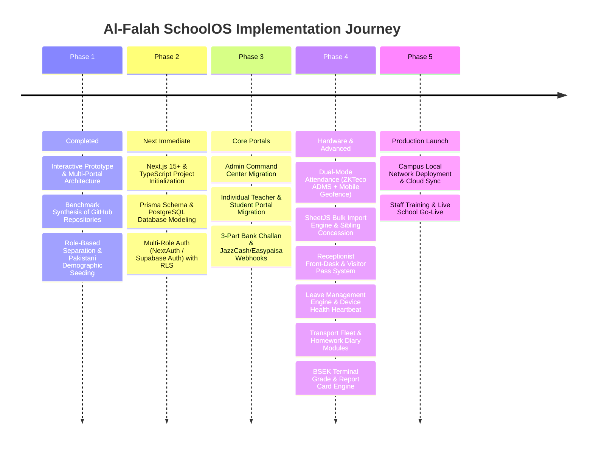

# Al-Falah SchoolOS — 0 to A-Z Master Goal & Complete Feature Roadmap

This document outlines the **complete, end-to-end vision, functional scope, and phase-by-phase implementation roadmap** for the **Al-Falah School Management System**. It synthesizes the most effective architectures, modules, and user interfaces identified across our benchmarked GitHub repositories and team engineering specifications (Hoorain & Zainab), enhanced with ground-reality Pakistani institutional features.

---

## 1. The Core Vision: An A-to-Z Pakistani School Management System

Most school management systems available today are either generic Western-focused clones or incomplete student directories. **Al-Falah SchoolOS** is engineered specifically around the operational realities of private and semi-private institutions in Pakistan (affiliated with BSEK / BISE Boards), featuring:

1. **True Role-Based Access Control (RBAC):** Strict isolation between Super Administration, Principal Executive Desk, Individual Teacher Workspaces, Student/Parent Dashboards, Accounts Desks, and Receptionist Front-Desk.
2. **Pakistani Banking & Dual Payment Channels:**
   - Triplicate bank challan vouchers (Bank Copy, School Copy, Student Copy) compatible with local banks (Meezan Bank, HBL, Bank Alfalah) with late fee rules.
   - Instant digital mobile wallet payments via **JazzCash & Easypaisa webhooks**.
3. **Dual-Mode Attendance Infrastructure (Hardware + Zero-Hardware Mobile Modes):**
   - **Mode A (Hardware Terminals):** ZKTeco / eSSL devices over TCP/IP 4370 & ADMS with duplicate punch idempotency filters, offline buffering, and auto clock-in/out.
   - **Mode B (Zero-Hardware Cost — $0 Capex):** For schools without budget for machines, teachers check in on their own smartphones using **GPS Campus Geofencing (< 50m radius) + W3C WebAuthn Native Phone Fingerprint / FaceID**.
4. **BSEK Matriculation Examination Engine:** Terminal marksheets calculating Continuous Assessment (CA 40%) and Final Terminal Exam (60%) with GPA and Grade distributions.
5. **Front-Desk Reception & Gate Pass Operations:** Visitor registry with CNIC tracking, admission enquiry follow-ups, and 1-click certificate generation (Leaving, Bonafide, Character).
6. **Sibling Concession & Family Linking:** Automated discounts for families with multiple enrolled children (e.g., 20% on 2nd child, 50% on 3rd child).
7. **Leave Management & Approval Workflows:** Digital leave requests for faculty and students with Principal approval queues.
8. **SheetJS Excel/CSV Bulk Onboarding:** 1-Click bulk student and teacher import directly from administration spreadsheets.
9. **Transport Fleet Management:** Van routes, Orangi Town stops, driver dossiers, and transport fee ledgering.
10. **Digital Daily Diary & Homework:** Teacher assignment publishing, student submission tracking, and parent oversight.
11. **Automated Monthly Billing (`pg_cron`):** Zero-touch invoice generation on the 1st of every month with automated SMS alerts.

---

## 2. Benchmark Synthesis: Best Features from Analyzed Repositories

| Benchmark Repository / Spec | Best Feature Adopted into Our System |
| :--- | :--- |
| **Coderbeb SMS (Next.js 16)** | **Enterprise Staff Punctuality & Geofencing:** `staff_entry_time` (08:00 AM), `staff_grace_minutes` (15m), `geo_lat`, `geo_lng`, `geo_radius_meters`, and auto-late deduction. |
| **Maktab Academy (React + Supabase)** | **Gate Attendance Kiosk & Triplicate Challans:** USB barcode / RFID / biometric scanner kiosk with audio feedback, red overdue fee warning banner, and 3-part bank vouchers. |
| **LavSMS (Laravel 8)** | **BSEK Terminal Marksheets & Promotion Engine:** Continuous Assessment (CA 40%) + Exam (60%), psychomotor evaluations (1-5 scale), and broadsheet master tabulation grids. |
| **Hafizur Madrasa (Next.js)** | **Biometric Sync API & Parent SMS:** Live hardware punch feed stream and automated SMS notifications to parents when a child is absent. |
| **Upendra Dhamala SMS** | **Non-Teaching Staff & 110mm Admit Cards:** Dedicated operational staff management (drivers, security, lab technicians) with separate payroll and photo exam admit passes. |
| **Hoorain's Engineering Plan** | **Biometric ADMS/TCP Hardware Pipeline:** Idempotency duplicate filter, offline buffer resilience, Device Heartbeat Health Dashboard, Receptionist Portal, and Leave Workflows. |
| **Zainab's Technical Plan** | **Pakistani Mobile Wallets:** JazzCash / Easypaisa webhooks, Sibling Discount Engine, SheetJS Bulk Excel Import, and pg_cron automated billing. |

---

## 3. Comprehensive Module Specifications (A to Z Scope)

### 3.1 👑 Module 1: Super Admin / School Executive Command Center
The central operational brain used by the School Principal, Chairman, and Administrative Directors.
* **Executive Metrics Dashboard:** Total enrollment, current day faculty attendance percentage, monthly tuition collection rate, outstanding arrears, and active board notices.
* **Teaching Faculty Management (14+ Teachers):**
  * Complete faculty directory with designations, educational qualifications, assigned subjects, and class incharge roles.
  * Comprehensive Teacher Dossier inspecting employment history, punctuality rate, and basic pay.
  * Faculty onboarding with CNIC, degree verification, and emergency contacts.
* **Attendance Mode Switcher & Geofence Boundary Setting:**
  * Configure campus GPS coordinates (Latitude, Longitude) and geofence boundary radius (e.g. 50 meters).
  * Toggle between Hardware Biometrics mode, Mobile Geofence mode, or Hybrid Mode.
* **Students Master Directory (Nursery through Class 10-A/B):**
  * Filterable directory by class, section, gender, and fee clearance status.
  * Student Comprehensive Dossier detailing academic performance, gate attendance history, and father contact.
  * Admission Registration workflow with automatic Roll Number generation, B-Form recording, and class allocation.
* **SheetJS 1-Click Bulk Importer:**
  * Import 500+ student rosters and faculty lists in seconds via Excel (.xlsx) or CSV files.
* **Master Timetable & Classroom Allocation:**
  * School-wide weekly schedule from Period 1 (08:30 AM) to Period 6 (12:30 PM).
  * Teacher substitute allocation when a teacher reports sick or on leave.
* **Daily School-wide Roll-Call Sheet:**
  * Consolidated attendance register across all classes with manual override capability.
* **Official Circulars & Notice Board:**
  * Authoring and publishing official school circulars (examination dates, parent-teacher meetings, public holidays, uniform notices).

---

### 3.2 👨‍🏫 Module 2: Individual Teacher Portal (Faculty Workspace)
A strictly personal workspace accessed by authenticated instructors (e.g. *Sir Tariq Mehmood*).
* **Personal KPI Dashboard:**
  * My Assigned Classes (e.g., Class 10-A, 9-A, 8-A).
  * Today's Gate Clock-in timestamp (e.g., `07:44 AM`) and punctuality badge.
  * Monthly attendance punctuality percentage (e.g., `98.5%`).
  * Monthly Salary Voucher status (e.g., `Rs 48,000 — Paid for October`).
* **Mobile Geofence & WebAuthn Check-In Button:**
  * If the school uses Zero-Hardware mode: Teacher taps "Mark Attendance", mobile GPS confirms presence within school perimeter (< 50m), phone prompts native fingerprint sensor, and attendance is verified.
* **My Class Students (Scoped Access):**
  * Shows *only* students enrolled in classes taught by this instructor.
  * Quick inspection of student attendance and current Continuous Assessment score.
  * Zero visibility into unauthorized classes or other teachers' private information.
* **My Teaching Routine & Timetable:**
  * Filtered timetable highlighting periods where this teacher is delivering lectures versus planning/free periods.
* **Daily Roll-Call Register (Class Incharge):**
  * Interactive roll-call interface allowing the class teacher to mark students Present, Absent, or Late.
  * One-click "Mark All Present" with instant status toggles.
* **Continuous Assessment (CA) & Midterm Marks Entry:**
  * Marksheet entry table for the teacher's designated subject (e.g., Mathematics).
  * Monthly test scores (out of 20), classroom quizzes (out of 20), automated CA total (40%), and terminal exam inputs (out of 60).
* **Digital Homework & Daily Diary Module:**
  * Upload daily subject homework, reading assignments, and project submission deadlines.
* **Leave Requests Tab:**
  * Submit medical/casual leave applications with reason and date range; track principal approval status.

---

### 3.3 🎓 Module 3: Individual Student & Parent Academic Portal
A private portal for students and their guardians (e.g. *Muhammad Faraz — Roll #12, Class 10-A*).
* **Personal Academic Spotlight:**
  * Full Name, Roll Number, Class & Section, Father's Name, and B-Form verification.
  * Overall Academic Standing: GPA (e.g., `3.84`), Final Grade (`A+`), Class Rank.
  * Gate Arrival Punctuality: Days present, average arrival time (`07:46 AM`).
  * Current Month Fee Status (`Cleared` vs `Arrears Overdue`).
* **My Registered Subjects & Course Instructors:**
  * Table of all enrolled curriculum subjects mapped to their respective instructors.
  * Continuous Assessment (40%) and Terminal Exam (60%) breakdown per subject.
* **Digital Daily Diary & Homework Tab:**
  * View today's pending homework assignments across all subjects and upload completed work.
* **My Class Timetable:**
  * Weekly routine for the student's specific section showing daily periods, break times, and lab sessions.
* **BSEK Terminal Marksheet (Downloadable/Printable):**
  * Official Karachi Secondary Board format report card with subject-wise marks, total obtained (out of 100 per subject), letter grades, and principal stamp.
* **Triplicate Bank Fee Challan Voucher & Online Mobile Payment:**
  * Complete 3-part bank voucher (Bank Copy, School Copy, Student Copy) with Meezan/HBL branch stamps.
  * **Pay via JazzCash / Easypaisa** one-click button for instant fee clearance.
* **110mm Examination Admit Card Pass:**
  * Photo-enabled official examination entry slip with roll number and hall seating assignment.

---

### 3.4 💰 Module 4: Accounts & Finance Desk
Dedicated administrative station for the school bursar and accounts officers.
* **Financial Overview Hub:**
  * Total billed tuition for the current month.
  * Reconciled collections via bank challans, counter cash, and online JazzCash/Easypaisa webhooks.
  * Monthly staff payroll expenditure across all instructional and non-instructional staff.
  * Outstanding arrears and active fee defaulters list.
* **Automated Monthly Billing Engine (`pg_cron`):**
  * Auto-generates monthly tuition challans on the 1st of every month for all enrolled students.
* **Sibling Concession Engine:**
  * Automatic fee reduction calculation for registered sibling groups.
* **3-Part Bank Challan Printing Engine:**
  * Bulk and single-voucher generation formatted for A4 standard triplicate printing.
* **Faculty Payroll Register:**
  * Disbursed salaries, basic pay, allowances, attendance-based deductions, and payment reference numbers.
* **Defaulter Recovery Alerts:**
  * Automated SMS and WhatsApp reminders dispatched to parents of defaulter students before exam deadlines.

---

### 3.5 🏢 Module 5: Receptionist & Front-Desk Operations
Dedicated operational desk for school receptionist and front-gate administrative staff.
* **Admission Inquiry Register:**
  * Track walk-in prospective students, parent contact, target grade, inquiry status, and scheduled admission test dates.
* **Visitor & Gate Pass Management:**
  * Record visitor full name, CNIC number, mobile number, meeting purpose, host faculty member, and entry/exit timestamps.
  * Generate printable Gate Passes for campus security.
* **Institutional Certificate Generator:**
  * 1-Click generation of standard student certificates: School Leaving Certificate (SLC), Character Certificate, and Bonafide Attestation.

---

### 3.6 🚌 Module 6: Transport & Van Fleet Management
* **Van & Bus Routes:** Route names, pickup/drop-off stops (e.g., Orangi Town Sectors 11½, 12, 14, 15).
* **Driver Dossiers:** Driver name, CNIC, contact phone number, vehicle registration number, and license status.
* **Transport Fee Allocation:** Monthly transportation charges automatically appended to the student's monthly fee challan.

---

### 3.7 ⏱️ Module 7: Biometric & RFID Hardware Attendance Engine (Mode A)
The hardware bridge that connects physical campus gate scanners to the web software.
* **Supported Protocols:** ZKTeco ADMS Cloud Push + pyzk TCP/IP Port 4370.
* **Device Health & Heartbeat Dashboard:**
  * Real-time monitoring of all on-campus biometric devices: IP Address, Serial Number, Online/Offline status, Last Ping, and pending sync count.
* **Idempotency & Duplicate Handling:**
  * Automatic filtering of accidental rapid taps using SHA-256 hash `hash(device_id + user_id + timestamp_minute)`.
* **Automated Clock-In & Clock-Out Aggregator:**
  * Earliest punch = Arrival Clock-In; Latest punch = Departure Clock-Out.
* **Punctuality & Salary Deduction Rules:**
  * Staff Cutoff: 07:45 AM (Punctual). 07:46–08:00 AM (Grace). 08:01+ AM (Late). 3 lates = 1/2 day basic salary deduction.
* **Principal Punctuality Leaderboard:**
  * Monthly Gold, Silver, Bronze faculty podium rankings and automated warning notice dispatch.
* **Offline Resilience:**
  * Hardware terminal local memory buffer storage during internet outages; auto-sync upon reconnection.
* **Instant Parent SMS Alerts:**
  * Automated SMS notification dispatched to parents when a child is not clocked in by 08:30 AM.

---

### 3.8 📱 Module 8: Zero-Hardware Cost Mobile Geofence & Biometric Engine (Mode B)
For schools opting out of physical biometric hardware purchases ($0 Capex option).
* **HTML5 Campus Geofencing:**
  * Teacher portal queries GPS coordinates upon tapping Check-in. Haversine algorithm calculates distance to school boundary. Denies check-in if distance > 50 meters.
* **W3C WebAuthn Biometric Prompt:**
  * Chrome/Safari natively triggers device fingerprint/FaceID sensor without any external app download.
* **Anti-Proxy Proof:**
  * Cryptographic hardware token + GPS coordinate stamp uploaded to cloud backend.

---

### 3.9 🏖️ Module 9: Leave Management & Approval Engine
* **Staff & Student Leave Applications:**
  * Submit leave requests with start/end date, type (Casual, Medical, Official), and attachment notes.
* **Principal Approval Queue:**
  * 1-Click Approve / Reject with remarks; automatic sync with monthly payroll deductions and attendance registers.

---

## 4. Phase-by-Phase Implementation Roadmap

### Phase 1: Prototype Architecture & Requirement Freezing (Completed)
* ✅ Full interactive single-page blueprint (`al_falah_grammar_school_showcase.html`).
* ✅ Strict RBAC simulation: Super Admin, Teacher (Sir Tariq), Student (Muhammad Faraz), and Accounts Desk.
* ✅ Authentic Karachi BSEK curriculum mapping, 25+ seeded students, and 14+ teachers.
* ✅ Repository synced on GitHub: [the-farazz/SMS](https://github.com/the-farazz/SMS.git).

### Phase 2: Production Full-Stack Scaffold (React / Next.js 15+)
* 🚀 Scaffold Next.js 15+ App Router project with TypeScript and Tailwind CSS.
* 🚀 Implement PostgreSQL database schema using Prisma ORM.
* 🚀 Multi-role Authentication system with secure sessions and role protection middleware (`/admin/*`, `/principal/*`, `/teacher/*`, `/student/*`, `/finance/*`, `/reception/*`, `/transport/*`).

### Phase 3: Enterprise Portals & Financial Engine
* 🚀 Port all high-fidelity UI components from blueprint into modular React components (`<TeacherWorkspace />`, `<StudentDashboard />`, `<FeeLedger />`).
* 🚀 Triplicate Bank Challan PDF generator + JazzCash / Easypaisa mobile wallet payment flow.
* 🚀 Sibling discount engine and pg_cron automated billing.

### Phase 4: Biometric Hardware Daemon & Advanced Operations
* 🚀 Deploy local TCP/IP & ADMS edge daemon (`pyzk`) with idempotency duplicate filter.
* 🚀 Implement **Mobile Geofence (<50m) + WebAuthn Fingerprint Check-In** for zero-hardware mode.
* 🚀 Biometric device health heartbeat registry in Super Admin.
* 🚀 Receptionist Front-Desk Portal (Admission enquiries, Visitor register, Gate passes, Certificates).
* 🚀 Leave Management & Principal Approval queue.
* 🚀 SheetJS 1-click bulk student and faculty Excel importer.
* 🚀 BSEK Continuous Assessment (40%) + Terminal (60%) mark aggregation engine.
* 🚀 Transport fleet module and digital homework diary.

### Phase 5: Production Deployment & Campus Handover
* 🚀 Deployment to Vercel/Railway with Cloudflare security.
* 🚀 Campus local caching to guarantee offline functionality during internet downtime.
* 🚀 Administrative, faculty, and reception staff training sessions.
