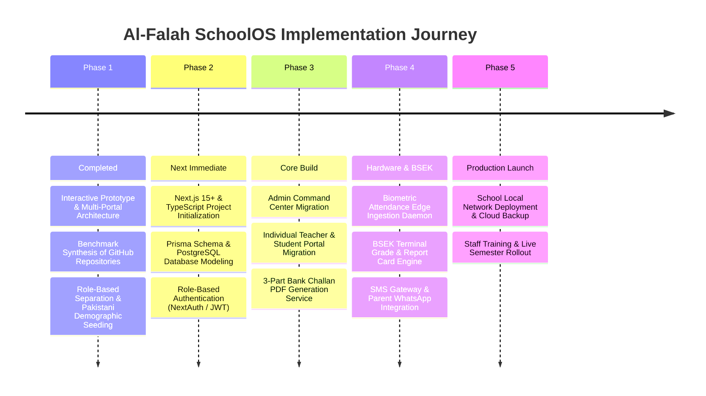

# Al-Falah SchoolOS — 0 to A-Z Master Goal & Complete Feature Roadmap

This document outlines the **complete, end-to-end vision, functional scope, and phase-by-phase implementation roadmap** for the **Al-Falah School Management System**. It synthesizes the most effective architectures, modules, and user interfaces identified across our benchmarked GitHub repositories.

---

## 1. The Core Vision: An A-to-Z Pakistani School Management System

Most school management systems available today are either generic Western-focused clones or incomplete student directories. **Al-Falah SchoolOS** is engineered specifically around the operational realities of private and semi-private institutions in Pakistan (affiliated with BSEK / BISE Boards), featuring:

1. **True Role-Based Access Control (RBAC):** Strict isolation between Super Administration, Individual Teacher Workspaces, Student/Parent Dashboards, and Accounts Desks.
2. **Pakistani Banking & Fee Recovery:** Triplicate bank challan vouchers (Bank Copy, School Copy, Student Copy) compatible with local banks (Habib Bank Limited, Meezan Bank, Bank Alfalah), with late fine rules and monthly reconciliation.
3. **Biometric & Hardware Attendance:** Direct integration with fingerprint scanners and facial recognition devices for automatic staff and student clock-in logging.
4. **BSEK Matriculation Examination Engine:** Terminal marksheets calculating Continuous Assessment (CA 40%) and Final Terminal Exam (60%) with GPA and Grade distributions.
5. **Modern Full-Stack Engineering:** Seamless evolution from verified HTML/JS interactive blueprints to a scalable **Next.js 15+ / PostgreSQL / Prisma** production web app.

---

## 2. Benchmark Synthesis: Best Features from Analyzed GitHub Repositories

| Benchmark Repository | Showcase File | Best Feature Adopted into Our System |
| :--- | :--- | :--- |
| **LavSMS (Laravel SMS)** | `03_LavSMS_Laravel_Modules_showcase.html` | **Enterprise Fee & Challan Engine:** Triplicate voucher structure, arrears carry-forward, fee concession management, and defaulter tracking. |
| **Upendra School SMS** | `05_Upendra_School_Management_showcase.html` | **Academic Timetable & Class Routine Matrix:** Conflict-free weekly schedules, teacher lecture workloads, and room assignments. |
| **Yogndrr MERN School** | `07_Yogndrr_MERN_School_showcase.html` | **Clean Modular Navigation & Component Cards:** Fast state updates, notice board feeds, and grievance/complaint routing. |
| **ApexSchool Flagship OS** | `00_FLAGSHIP_ApexSchool_OS_showcase.html` | **Executive KPI Analytics & BSEK Grade Engine:** High-level executive counters, student GPA calculation, and faculty punctuality indicators. |
| **ScholarOS & Maktab** | `06_ScholarOS_...` & `02_Maktab_...` | **Pakistani Context & Demographics:** B-Form verification, guardian contact mapping, and Islamic study tajweed records. |

---

## 3. Comprehensive Module Specifications (A to Z Scope)

### 3.1 👑 Module 1: Super Admin / School Executive Command Center
The central operational brain used by the School Principal, Chairman, and Administrative Directors.
* **Executive Metrics Dashboard:** Total enrollment, current day faculty attendance percentage, monthly tuition collection rate, outstanding arrears, and active board notices.
* **Teaching Faculty Management (14+ Teachers):**
  * Complete faculty directory with designations, educational qualifications, assigned subjects, and class incharge roles.
  * Comprehensive Teacher Dossier inspecting employment history, punctuality rate, and basic pay.
  * Faculty onboarding with CNIC, degree verification, and emergency contacts.
* **Students Master Directory (Nursery through Class 10-A/B):**
  * Filterable directory by class, section, gender, and fee clearance status.
  * Student Comprehensive Dossier detailing academic performance, gate attendance history, and father contact.
  * Admission Registration workflow with automatic Roll Number generation, B-Form recording, and class allocation.
* **Master Timetable & Classroom Allocation:**
  * School-wide weekly schedule from Period 1 (08:30 AM) to Period 6 (12:30 PM).
  * Teacher substitute allocation when a teacher reports sick or on leave.
* **Daily School-wide Roll-Call Sheet:**
  * Consolidated attendance register across all classes with manual override capability.
* **Official Circulars & Notice Board:**
  * Authoring and publishing official school circulars (examination dates, parent-teacher meetings, public holidays, uniform notices).

---

### 3.2 👨‍🏫 Module 2: Individual Teacher Portal (Faculty Workspace)
A strictly personal workspace accessed by authenticated instructors (e.g. *Sir Tariq Mehmood*).
* **Personal KPI Dashboard:**
  * My Assigned Classes (e.g., Class 10-A, 9-A, 8-A).
  * Today's Gate Clock-in timestamp (e.g., `07:44 AM`) and punctuality badge.
  * Monthly attendance punctuality percentage (e.g., `98.5%`).
  * Monthly Salary Voucher status (e.g., `Rs 48,000 — Paid for October`).
* **My Class Students (Scoped Access):**
  * Shows *only* students enrolled in classes taught by this instructor.
  * Quick inspection of student attendance and current Continuous Assessment score.
  * Zero visibility into unauthorized classes or other teachers' private information.
* **My Teaching Routine & Timetable:**
  * Filtered timetable highlighting periods where this teacher is delivering lectures versus planning/free periods.
* **Daily Roll-Call Register (Class Incharge):**
  * Interactive roll-call interface allowing the class teacher to mark students Present, Absent, or Late.
  * One-click "Mark All Present" with instant status toggles.
* **Continuous Assessment (CA) & Midterm Marks Entry:**
  * Marksheet entry table for the teacher's designated subject (e.g., Mathematics).
  * Monthly test scores (out of 20), classroom quizzes (out of 20), automated CA total (40%), and terminal exam inputs (out of 60).
* **Staff Circulars & Notifications:**
  * Internal faculty notices, duty rosters (morning assembly, break monitoring), and academic coordinator directives.

---

### 3.3 🎓 Module 3: Individual Student & Parent Academic Portal
A private portal for students and their guardians (e.g. *Muhammad Faraz — Roll #12, Class 10-A*).
* **Personal Academic Spotlight:**
  * Full Name, Roll Number, Class & Section, Father's Name, and B-Form verification.
  * Overall Academic Standing: GPA (e.g., `3.84`), Final Grade (`A+`), Class Rank.
  * Gate Arrival Punctuality: Days present, average arrival time (`07:46 AM`).
  * Current Month Fee Status (`Cleared` vs `Arrears Overdue`).
* **My Registered Subjects & Course Instructors:**
  * Table of all enrolled curriculum subjects mapped to their respective instructors (e.g., Mathematics -> Sir Tariq, Physics -> Sir Asadullah).
  * Continuous Assessment (40%) and Terminal Exam (60%) breakdown per subject.
* **My Class Timetable:**
  * Weekly routine for the student's specific section showing daily periods, break times, and lab sessions.
* **BSEK Terminal Marksheet (Downloadable/Printable):**
  * Official Karachi Secondary Board format report card with subject-wise marks, total obtained (out of 100 per subject), letter grades, and principal stamp.
* **Triplicate Bank Fee Challan Voucher:**
  * Complete 3-part bank voucher (Bank Copy, School Copy, Student Copy).
  * Itemized breakdown: Monthly Tuition (e.g., Rs 3,200) + Computer/Lab Fee (Rs 500) = Total Rs 3,700.
  * Designated HBL / Meezan Bank Orangi Town branch stamps, due date, and barcode/challan reference.
* **School Notices:**
  * Parent bulletins, holiday announcements, and exam date sheets.

---

### 3.4 💰 Module 4: Accounts & Finance Desk
Dedicated administrative station for the school bursar and accounts officers.
* **Financial Overview Hub:**
  * Total billed tuition for the current month.
  * Reconciled collections via bank challans and counter cash.
  * Monthly staff payroll expenditure across all 14 instructional and non-instructional staff.
  * Total outstanding arrears and active fee defaulters list.
* **Fee Master Ledger:**
  * Complete roll-number-wise fee ledger with status badges (`Paid in Full`, `Arrears Overdue`, `Partial Payment`).
* **3-Part Bank Challan Printing Engine:**
  * Bulk and single-voucher generation formatted for A4 standard triplicate printing.
* **Faculty Payroll Register:**
  * Disbursed salaries, basic pay, allowances, attendance-based deductions, and payment reference numbers.
* **Fee Defaulter Recovery Alerts:**
  * Generation of reminder circulars for students with overdue balances prior to admit card issuance.

---

### 3.5 ⏱️ Module 5: Biometric & RFID Attendance Integration Engine
The hardware bridge that connects physical campus gate scanners to the web software.
* **Supported Devices:** ZKTeco K40, VF380, MB20, and TCP/IP-enabled biometric attendance clocks.
* **Edge Ingestion Daemon:**
  * A lightweight background process (Python `pyzk` daemon or Go binary) running on the local campus server.
  * Continuously listens to device sockets, captures punch records (`User_ID`, `Timestamp`, `Verification_Type`).
* **Punctuality Calculation Engine:**
  * Staff Cutoff: 07:45 AM (Punctual). 07:46–08:00 AM (Grace). 08:01+ AM (Late).
  * Automated generation of monthly attendance summaries for payroll deduction calculations.
* **Instant Parent SMS Alerts:**
  * Integration with local Pakistani SMS gateways (e.g., Telco SMS, BrandSMS) to alert parents if a student has not clocked in by 08:30 AM.

---

## 4. Phase-by-Phase Implementation Roadmap

### Phase 1: Prototype Architecture & Requirement Freezing (Current Stage)
* ✅ Full interactive single-page blueprint (`al_falah_grammar_school_showcase.html`).
* ✅ Strict RBAC simulation: Super Admin, Teacher (Sir Tariq), Student (Muhammad Faraz), and Accounts Desk.
* ✅ Authentic Karachi BSEK curriculum mapping, 25+ seeded students, and 14+ teachers.
* ✅ Live Cloudflare tunnel demonstration for team review.

### Phase 2: Production Full-Stack Scaffold (React / Next.js)
* 🚀 Scaffold Next.js 15+ App Router project with TypeScript and Tailwind CSS.
* 🚀 Implement PostgreSQL database schema using Prisma ORM.
* 🚀 Multi-role Authentication system with secure sessions and role protection middleware (`/admin/*`, `/teacher/*`, `/student/*`, `/finance/*`).

### Phase 3: Enterprise Features & Financial Engine
* 🚀 Port all high-fidelity UI components from the blueprint into modular React components (`<TeacherWorkspace />`, `<StudentDashboard />`, `<FeeLedger />`).
* 🚀 Triplicate Bank Challan PDF generator rendering print-ready vouchers.
* 🚀 TanStack Table integration for student rosters with CSV/Excel exports.

### Phase 4: Biometric Hardware Daemon & Karachi Board Grading
* 🚀 Build the local TCP/IP edge daemon to sync biometric clock-in punches to cloud database.
* 🚀 Build the automated BSEK Continuous Assessment (40%) + Terminal (60%) mark aggregation engine.
* 🚀 Integrate Pakistani SMS gateway for gate arrival alerts.

### Phase 5: Production Deployment & Campus Handover
* 🚀 Deployment to Vercel/Railway with Cloudflare security.
* 🚀 Local caching on school campus PC to guarantee offline functionality during internet downtime.
* 🚀 Administrative and teacher training sessions.
