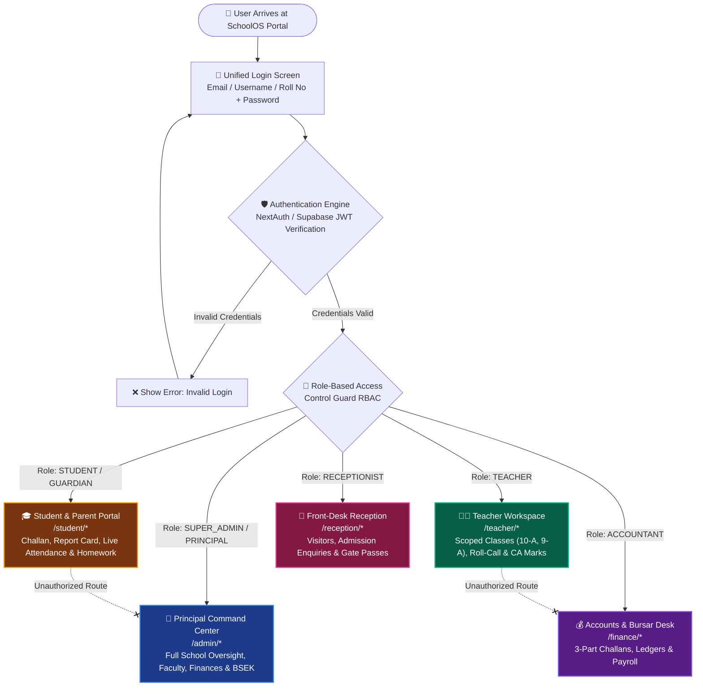
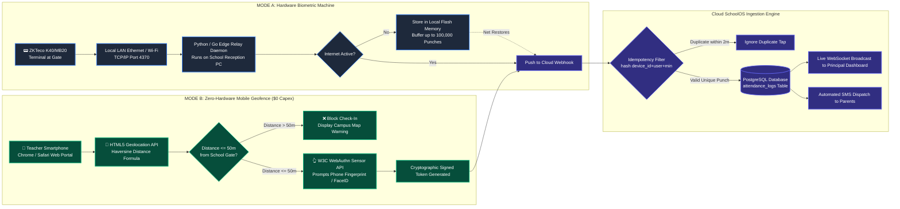

# Al-Falah SchoolOS — Visual System Workflows & Architecture Flowcharts

This document provides complete, interactive **Mermaid.js architectural and user journey flowcharts** for Al-Falah SchoolOS. These diagrams visually demonstrate how every persona operates — from login, morning gate attendance, and classroom teaching to fee recovery and BSEK examination results.

---

## 🗺️ 1. Master Authentication & Role-Based Access Isolation Flow

This flowchart illustrates how a single unified login portal strictly isolates Super Admins, Teachers, Students/Parents, Accounts, and Receptionists without cross-data leakage.



---

## 👑 2. Super Admin & Principal Executive Command Center Flow

This flowchart shows the Principal's daily morning-to-evening administrative workflow.

```mermaid
flowchart TD
    LoginAdmin[👑 Principal Logged In] --> AdminDash[📊 Executive Morning Dashboard]
    
    AdminDash --> Metric1[⏱️ Faculty Attendance Counter<br>14/14 Faculty Present | 98.5% Punctuality]
    AdminDash --> Metric2[💰 Monthly Fee Recovery Rate<br>PKR 840,000 / 1,050,000 Recovered]
    AdminDash --> Metric3[🎓 Student Enrollment Matrix<br>520 Active Students Across 10 Grades]
    
    AdminDash --> AdminActions{⚙️ Administrative Actions}
    
    AdminActions --> M1[👨‍🏫 Faculty Management]
    M1 --> M1_1[Inspect Faculty Profiles & Basic Salaries]
    M1 --> M1_2[🏆 Punctuality Podium: Gold, Silver, Bronze Teachers]
    M1 --> M1_3[Issue Automated Tardiness Warnings for Late Arrival]
    
    AdminActions --> M2[🎓 Student Admissions & Registry]
    M2 --> M2_1[📥 SheetJS 1-Click Excel Bulk Import 500+ Students]
    M2 --> M2_2[Student Comprehensive Dossier & B-Form Checks]
    M2 --> M2_3[Allocate Classes, Roll Numbers & Sections]
    
    AdminActions --> M3[📡 Dual Attendance Engine Config]
    M3 --> M3_1[Monitor ZKTeco Device Heartbeats IP 192.168.1.201]
    M3 --> M3_2[Set Campus GPS Geofence Boundary < 50m Radius]
    M3 --> M3_3[Configure 15-Minute Staff Grace Period Cutoff]
    
    AdminActions --> M4[📋 BSEK Examination Final Lock]
    M4 --> M4_1[Audit Continuous Assessment 40% Scores]
    M4 --> M4_2[Audit Terminal Examination 60% Scores]
    M4 --> M4_3[1-Click Publish Official Karachi Board Marksheets]
```

---

## 👨‍🏫 3. Individual Teacher Complete Daily Lifecycle Flow

This flowchart illustrates an instructor's (e.g. *Sir Tariq Mehmood*) journey from morning gate arrival to classroom roll-call, grading, and departure.

```mermaid
flowchart TD
    Arrive[🚶 Teacher Arrives at School Campus] --> SelectMode{Option: How to Clock In?}
    
    SelectMode -- Option A: Hardware Machine --> ZKPunch[📟 ZKTeco Terminal at Gate<br>Touch Physical Fingerprint Sensor]
    ZKPunch --> IdempotencyCheck{SHA-256 De-duplication<br>Was punch within 2 minutes?}
    IdempotencyCheck -- Yes --> Ignore[Ignore Duplicate Tap]
    IdempotencyCheck -- No --> HardwareSuccess[✅ Clock-In Logged via TCP/IP 4370]
    
    SelectMode -- Option B: Zero-Hardware Mobile ($0) --> MobileApp[📱 Open Teacher Portal on Phone<br>Tap 'Mark Attendance' Button]
    MobileApp --> GeoCheck{📍 GPS Geofence Verification<br>Distance to School Boundary?}
    GeoCheck -- Distance > 50m --> GeoFail[❌ Access Denied: You are outside campus!]
    GeoCheck -- Distance <= 50m --> WebAuthnPrompt[👆 Native Phone Fingerprint Sensor Prompt<br>W3C WebAuthn API]
    WebAuthnPrompt --> MobileSuccess[✅ Clock-In Logged via Mobile Geofence]
    
    HardwareSuccess --> PunctualityEngine{⏱️ Arrival Time Check}
    MobileSuccess --> PunctualityEngine
    
    PunctualityEngine -- Before 08:00 AM --> PunctualBadge[🟢 Marked ON-TIME]
    PunctualityEngine -- 08:01 to 08:15 AM --> GraceBadge[🟡 Marked LATE (Grace Active)]
    PunctualityEngine -- After 08:15 AM --> LateBadge[🔴 Marked LATE (3 Lates = 1/2 Day Cut)]
    
    PunctualBadge --> ClassroomWork[🏫 Proceed to Classroom Teaching]
    GraceBadge --> ClassroomWork
    LateBadge --> ClassroomWork
    
    ClassroomWork --> ClassRoutine{Daily Tasks Inside Teacher Portal}
    
    ClassRoutine --> Task1[📋 Period 1: Daily Roll-Call Register<br>1-Click Mark All Present for Class 10-A]
    ClassRoutine --> Task2[📝 Period 3: Continuous Assessment CA 40%<br>Input Mathematics Monthly Test & Quizzes]
    ClassRoutine --> Task3[📖 Period 6: Digital Homework Diary<br>Attach Math Exercise PDF with Due Date]
    
    ClassRoutine --> Depart[🚪 01:45 PM: Departure Time]
    Depart --> ClockOut[👆 Touch Biometric / Mobile Check-Out]
    ClockOut --> ComputeHours[System Computes Total Shift: 6 Hours 00 Minutes]
```

---

## 🎓 4. Student & Parent Academic, Fee & Examination Journey

This flowchart traces a student's (e.g. *Muhammad Faraz — Roll #12*) full academic and billing lifecycle.

```mermaid
flowchart TD
    StudentArrival[🎒 Student Enters School Gate] --> GatePunch[👆 Fingerprint Scan at Gate Scanner]
    GatePunch --> GateServer[Server Ingests Arrival Timestamp: 07:46 AM]
    GateServer --> ParentSMS[📩 Automated Instant SMS to Father:<br>'Muhammad Faraz arrived safely at school at 07:46 AM']
    
    ParentSMS --> ParentPortal[👨‍👩‍👧 Parent Logs into School Portal]
    ParentPortal --> ViewDash[Check Child Attendance, Test Marks & Diary]
    
    ViewDash --> BillingCycle{📅 1st of Month: Automated Billing pg_cron}
    BillingCycle --> SiblingCheck{Check Sibling Concession}
    SiblingCheck -- 2nd Enrolled Child --> ApplyDiscount[Apply 20% Concession on Tuition Fee]
    SiblingCheck -- 1st / Only Child --> StandardFee[Standard Tuition Fee]
    
    ApplyDiscount --> GenerateChallan[📄 Generate Triplicate Fee Challan]
    StandardFee --> GenerateChallan
    
    GenerateChallan --> PaymentMethod{Choose Payment Method}
    
    PaymentMethod -- Option A: Bank Counter --> PrintVoucher[🖨️ Print 3-Part Bank Challan<br>Bank Copy · School Copy · Student Copy]
    PrintVoucher --> BankDeposit[Deposit Cash at Meezan / HBL Branch]
    BankDeposit --> BankReconcile[Bursar Reconciles Voucher Code]
    
    PaymentMethod -- Option B: Instant Mobile Pay --> OnlinePay[📱 Tap 'Pay via JazzCash / Easypaisa']
    OnlinePay --> WebhookIPN[⚡ Instant Payment Gateway Webhook Confirmation]
    
    BankReconcile --> FeeCleared[🟢 Fee Status: FULLY CLEARED]
    WebhookIPN --> FeeCleared
    
    FeeCleared --> ExamEligibility{Exams Approaching?}
    ExamEligibility -- Yes --> AdmitCard[🎟️ 1-Click Download 110mm Examination Admit Card<br>Photo, Roll No, Hall Seating & Seal]
    
    AdmitCard --> FinalExams[✍️ Appears in Terminal Examinations]
    FinalExams --> ResultPub[📊 Terminal Result Published]
    ResultPub --> DownloadMarksheet[📜 Download BSEK Report Card<br>40% CA + 60% Terminal = Final Letter Grade A+]
```



---

## ⏱️ 5. Dual Attendance Decision Engine: Hardware vs Zero-Hardware Mobile

This flowchart explicitly contrasts how the system processes on-campus physical devices versus zero-hardware mobile check-ins.



---

## 📌 Summary for Presentations
These flowcharts give school owners and technical committees complete visual clarity:
1. **Privacy:** No cross-role data leaks between teachers and students.
2. **Flexibility:** Schools can adopt **Zero-Hardware Mobile Geofencing ($0 cost)** immediately, or connect their existing **ZKTeco machines**.
3. **Local Reliability:** Designed specifically for Pakistani internet drops, BSEK exam formats, and Meezan/HBL bank vouchers.
